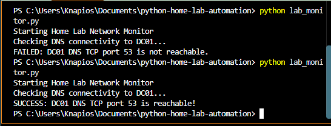

# Python Network Connectivity Mini Lab

A small Python project I built to check whether the DNS TCP port on my Hyper-V domain controller is reachable.

## What the script does

`lab_monitor.py` uses Python's built-in `socket` module to attempt one TCP connection to **DC01 (`10.10.10.10`) on port 53**, with a three-second timeout. It checks the result from `connect_ex()`, prints **SUCCESS** or **FAILED**, and closes the socket.

## What I tested

I ran the script from my Windows host against my Windows Server 2025 VM:

| Test | Observed result |
|---|---|
| DC01 was offline | `FAILED: DC01 DNS TCP port 53 is not reachable.` |
| DC01 was started | `SUCCESS: DC01 DNS TCP port 53 is reachable!` |

The screenshot shows both runs from the completed lab on **21 November 2026**.



## Run it

Install Python 3 and run the following from the project folder:

```powershell
python lab_monitor.py
```

The host needs a route to the lab network. Change `server_ip` in the script if your target uses a different address. No third-party packages are required.

## What I learned

- Importing and using Python's standard library.
- Storing a target address in a variable.
- Creating a socket and setting a timeout.
- Using an `if`/`else` statement to report a connection result.
- Comparing failed and successful checks while troubleshooting VM availability.

This is a single TCP reachability check, not a continuous monitor. Reaching TCP port 53 does **not** verify DNS name resolution or UDP DNS traffic. A failed connection can have several causes; in this test, starting DC01 restored connectivity.

**Status: mini lab complete.** The script is the original version used for these tests.
